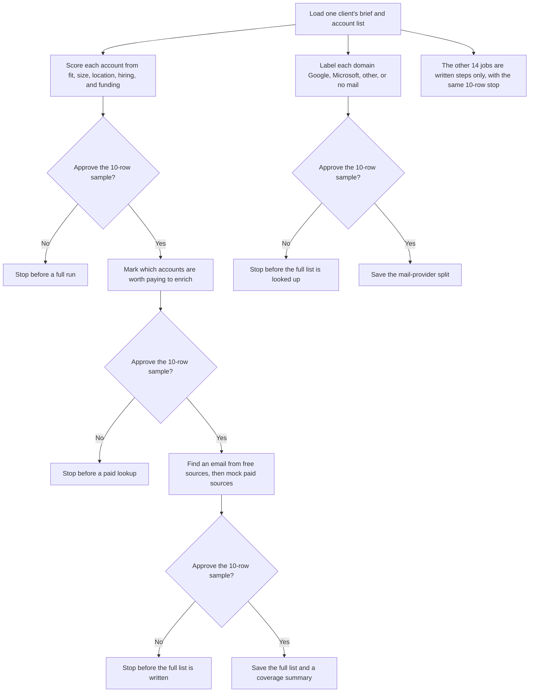

# gtm-engineer-skill-pack

The 18 jobs a GTM engineer does, each written as an agent skill you can trigger with one message, and each gated on a 10-row sample before anything runs at scale.

The list of 18 comes from a public post that asked "What on earth is a GTM engineer?". Four of the jobs have working, offline Python here. The rest are written as specs.

## How it works



A shared gate runs the chosen job on the first 10 rows, writes a sample, and waits. A person has to pass `--approve` before the same job runs on every row. Nothing is paid for, sent, or written to a CRM before that. Scoring, qualifying, and enrichment are run in that order. Mail-provider lookup is a separate step and can use an offline fixture or live DNS. The other fourteen jobs describe the same stop, and they do not have code yet.

## The pattern
1. **Feed the agent everything on one client:** brief, ICP, offer, past campaigns, CRM exports.
2. **Research the market and the buyers** before writing any rule.
3. **Turn each job into a one-message skill** (`skills/<job>/SKILL.md`).
4. **Gate every skill to 10 sample rows, then wait for approval.** Nothing paid, sent or written to a CRM happens before a human approves. See `gtm/gate.py`.

## The 18 jobs
| # | Job | Skill | Code |
|---|---|---|---|
| 1 | maps every company in the market & scores all of them | `skills/01-map-and-score-market/` | ✅ `score_accounts.py` |
| 2 | qualifies each one with AI before paying to enrich it | `skills/02-qualify-before-enrich/` | ✅ `qualify.py` |
| 3 | runs a waterfall of data providers for 85%+ coverage | `skills/03-waterfall-enrichment/` | ✅ `waterfall.py` |
| 4 | scrapes info@ emails that convert at twice the paid rate | `skills/04-scrape-role-inboxes/` | spec |
| 5 | pulls MX records so Google & Microsoft get their own copy | `skills/05-mx-provider-split/` | ✅ `mx_lookup.py` |
| 6 | warms the inboxes for 3 weeks before a single cold send | `skills/06-inbox-warmup/` | spec |
| 7 | scores accounts on who's hiring & who just raised | `skills/07-hiring-and-funding-signals/` | spec |
| 8 | reads job posts to find who's hiring the role you replace | `skills/08-job-post-replacement-signal/` | spec |
| 9 | writes one message per pain & lets the list personalise | `skills/09-pain-based-messaging/` | spec |
| 10 | launches 15 variants & kills the bottom two thirds | `skills/10-variant-testing/` | spec |
| 11 | pipes every reply into Slack with the prospect's number | `skills/11-replies-to-slack/` | spec |
| 12 | gets a human calling positive replies inside 5 minutes | `skills/12-five-minute-callback/` | spec |
| 13 | logs every "we already have a vendor" with its renewal date | `skills/13-vendor-renewal-log/` | spec |
| 14 | re-enriches the list monthly, since 30-50% of it moves | `skills/14-monthly-re-enrichment/` | spec |
| 15 | splits reply rate by segment so the average can't hide | `skills/15-segment-reply-rates/` | spec |
| 16 | runs the phone off the same list as the email | `skills/16-phone-off-same-list/` | spec |
| 17 | builds Claude skills that run all of this from Slack | `skills/17-skills-from-slack/` | spec |
| 18 | finds what every closed-won account had before it bought | `skills/18-closed-won-lookback/` | spec |

## Run the demos (no API keys, no network needed except MX)
```bash
python skills/01-map-and-score-market/score_accounts.py data/sample_accounts.csv            # sample of 10, then stops
python skills/01-map-and-score-market/score_accounts.py data/sample_accounts.csv --approve  # full run
python skills/02-qualify-before-enrich/qualify.py out/01-map-and-score-market/full.csv --approve
python skills/03-waterfall-enrichment/waterfall.py out/02-qualify-before-enrich/full.csv --approve
python skills/05-mx-provider-split/mx_lookup.py data/sample_accounts.csv --offline           # use --live for real DNS
python -m unittest discover -s tests -v
```

- **Account scoring:** a transparent points model (ICP fit + hiring + funding signals) with a reason for every point.
- **Qualify before enrich:** a rule-based stand-in for the AI call (swap in any LLM behind `classify()`). Only qualified rows go on to paid enrichment, and the script reports how many paid lookups it avoided.
- **Waterfall enrichment:** mock providers ordered free-first, then paid. It stops at the first verified hit and logs the provider and the mock cost.
- **MX lookup:** classifies each domain as Google, Microsoft or other using free public DNS (`dnspython`). It has an offline fixture mode for tests.

All data in `data/` is fictional placeholder data (`example.com` and `example.org` domains, names such as Jane Doe and John Smith, companies such as Example Org and Acme Corp). There are no API keys and no real personal data.

## Requirements
Python 3.10+. `dnspython` is needed only for `mx_lookup.py --live`.

## License
MIT
